# LawyerUp code tour

A five-minute walkthrough of how LawyerUp works, for demos and interviews. Every link points at the exact lines, pinned to commit [`ea04690`](https://github.com/Taserface0/lawyerup/tree/ea04690b9d5d02d297cb42232dd7e77bacf832ae) so the line numbers stay correct as the code moves on.

**Honest scope:** LawyerUp uses large language models (Google Gemini or Anthropic Claude) through their APIs. It does not train or fine-tune a model and does not use embeddings. The engineering is everything around the model: retrieval, context, guardrails, structured output, evaluation, and the backend that stores accounts, bookings and chats.

## The request flow

```mermaid
flowchart LR
  A[Browser: question] --> B["/api/chat (server)"]
  B --> C[sanitizeHistory: 12 turns, 2,000 chars]
  C --> D[redactPII + detectCrisis]
  D --> E[retrieve: BM25 over 46 law passages]
  E --> F["buildUserTurn: &lt;sources&gt; + escaped &lt;user_question&gt;"]
  F --> G[LLM: cached system prompt + JSON schema]
  G --> H[parse JSON, handle refusal / truncation]
  H --> I[groundCitations: drop citations not retrieved]
  I --> J[answer + sources + urgency, structured log]
```



All of it is one function: [`handleChat` in `server/chatHandler.js`, lines 42-144](https://github.com/Taserface0/lawyerup/blob/ea04690b9d5d02d297cb42232dd7e77bacf832ae/server/chatHandler.js#L42-L144). Its steps are commented `1. sanitize` to `6. observe`.

---

## 1. LLM integration (transformer models via API)

The server builds one provider-neutral request; an adapter translates it for Gemini, and the official SDK sends it to Claude.

[`server/chatHandler.js#L78-L84`](https://github.com/Taserface0/lawyerup/blob/ea04690b9d5d02d297cb42232dd7e77bacf832ae/server/chatHandler.js#L78-L84) · adapter: [`server/geminiClient.js#L31-L49`](https://github.com/Taserface0/lawyerup/blob/ea04690b9d5d02d297cb42232dd7e77bacf832ae/server/geminiClient.js#L31-L49) · provider choice: [`server/provider.js#L12`](https://github.com/Taserface0/lawyerup/blob/ea04690b9d5d02d297cb42232dd7e77bacf832ae/server/provider.js#L12)

```js
  const response = await createMessage({
    model,
    max_tokens: 8000,
    system: [{ type: 'text', text: SYSTEM_PROMPT, cache_control: { type: 'ephemeral' } }],
    messages,
    output_config: { effort: 'low', format: { type: 'json_schema', schema: RESPONSE_SCHEMA } },
  });
```

**What to say:** "The pipeline is provider-agnostic: `createMessage` is injected, so the same guardrails and retrieval run on Gemini or Claude, and tests run with a fake model."

**Likely follow-up:** *Why not call the model from the browser?* The API key would be exposed to anyone. Only `server/` reads the key, and CI fails the build if a key pattern shows up in the browser bundle (section 9).

---

## 2. NLP: tokenising, stop words, stemming, multilingual keywords

The query and the law passages go through the same light text normalisation before scoring.

[`src/ai/retrieval.js#L20-L39`](https://github.com/Taserface0/lawyerup/blob/ea04690b9d5d02d297cb42232dd7e77bacf832ae/src/ai/retrieval.js#L20-L39)

```js
function stem(token) {
  if (!/^[a-z]+$/.test(token) || token.length <= 4) return token;
  return token.replace(/(ings|ing|ed|es|s)$/, '') || token;
}

export function tokenize(text) {
  return (text || '')
    .toLowerCase()
    .normalize('NFC')
    .split(/[^\p{L}\p{N}\p{M}]+/u)
    .filter((t) => t && !STOPWORDS.has(t))
    .map(stem);
}
```

Stop words cover English and Hinglish fillers (`mujhe`, `kya`, `hai`…). Hindi spellings and Hinglish phrases are curated as keywords on each passage in [`src/ai/knowledge.js`](https://github.com/Taserface0/lawyerup/blob/ea04690b9d5d02d297cb42232dd7e77bacf832ae/src/ai/knowledge.js#L22) (e.g. `'giraftaar'`, `'गिरफ्तार'`).

**What to say:** "Unicode-aware tokenising (it splits on letters, digits and combining marks, so Devanagari works), stop-word removal and light stemming. Hindi variants come from curated aliases rather than a Hindi stemmer."

**Likely follow-up:** *Why did "Can you hear me?" use to pull in a law about data rights?* Because "you"/"your" counted as keywords. They're stop words now, and an eval case (`smalltalk-hear-me`) guards it.

**Demo:** `npm test -- retrieval`

---

## 3. RAG: BM25 retrieval over a curated corpus

Each question is scored against 46 plain-language law passages with BM25, the classic search-engine ranking function, and the top few go to the model as sources.

[`src/ai/retrieval.js#L68-L94`](https://github.com/Taserface0/lawyerup/blob/ea04690b9d5d02d297cb42232dd7e77bacf832ae/src/ai/retrieval.js#L68-L94)

```js
      const df = index.df.get(term);
      const idf = Math.log(1 + (index.n - df + 0.5) / (df + 0.5));
      score += idf * ((f * (K1 + 1)) / (f + K1 * (1 - B + (B * d.length) / index.avgLength)));
    }
    for (const phrase of d.phrases) if (lowered.includes(phrase)) score += PHRASE_BONUS;
    ...
  return scored
    .filter((s) => s.score >= minScore && s.score >= best * relativeCutoff)
    .sort((a, b) => b.score - a.score)
    .slice(0, k);
```

`K1 = 1.4`, `B = 0.75` ([L15-L18](https://github.com/Taserface0/lawyerup/blob/ea04690b9d5d02d297cb42232dd7e77bacf832ae/src/ai/retrieval.js#L15-L18)); curated keywords count 3x and a verbatim multi-word keyword adds a bonus. The two cut-offs mean an off-topic question retrieves nothing instead of noise. Follow-ups work because the previous user turn is added to the query ([`server/chatHandler.js#L69-L71`](https://github.com/Taserface0/lawyerup/blob/ea04690b9d5d02d297cb42232dd7e77bacf832ae/server/chatHandler.js#L69-L71)).

**What to say:** "Retrieval-augmented generation: the model only answers from passages we retrieved from a small, curated, lawyer-checkable library."

**Likely follow-up:** *Why BM25 and not embeddings or a vector database?* With 46 passages and curated multilingual keywords, BM25 is fast, free, deterministic and easy to test; embeddings pay off with thousands of passages or very loose wording. The next step would be hybrid search (BM25 + embeddings) once the library grows.

**Demo:** `npm run eval` (retrieval recall for 39 golden questions).

---

## 4. Citation grounding (the hallucination check)

The model may only cite passages that were actually retrieved for this question; anything else is dropped and counted in the logs.

[`src/ai/prompt.js#L93-L104`](https://github.com/Taserface0/lawyerup/blob/ea04690b9d5d02d297cb42232dd7e77bacf832ae/src/ai/prompt.js#L93-L104)

```js
export function groundCitations(citationIds, retrievedIds) {
  const allowed = new Set(retrievedIds);
  const unique = [...new Set(Array.isArray(citationIds) ? citationIds : [])];
  const kept = unique.filter((id) => allowed.has(id) && KNOWLEDGE_BY_ID[id]);
  return {
    citations: kept.map((id) => {
      const { law, section, title } = KNOWLEDGE_BY_ID[id];
      return { id, law, section, title };
    }),
    dropped: unique.length - kept.length,
  };
```

**What to say:** "The sources under each answer come from our own records, not from the model's text, so the model can't invent a section number and show it as a source."

**Likely follow-up:** *How do you stop hallucinated citations?* Three layers: the prompt says to cite only `<sources>` ids, the JSON schema forces citations to be ids, and `groundCitations` drops any id that wasn't retrieved. `droppedCitations` is logged per turn.

**Demo:** ask "Police arrested my brother, what are his rights?" and point at the Sources list.

---

## 5. Context engineering

What the model sees is assembled deliberately: a stable system prompt, retrieved sources, a language hint, and the user's text escaped inside tags.

[`src/ai/prompt.js#L76-L86`](https://github.com/Taserface0/lawyerup/blob/ea04690b9d5d02d297cb42232dd7e77bacf832ae/src/ai/prompt.js#L76-L86) · system prompt: [`#L16-L44`](https://github.com/Taserface0/lawyerup/blob/ea04690b9d5d02d297cb42232dd7e77bacf832ae/src/ai/prompt.js#L16-L44) · history window: [`src/ai/guardrails.js#L97-L117`](https://github.com/Taserface0/lawyerup/blob/ea04690b9d5d02d297cb42232dd7e77bacf832ae/src/ai/guardrails.js#L97-L117)

```js
function escapeXml(text) {
  return text.replace(/[<>&]/g, (c) => ({ '<': '&lt;', '>': '&gt;', '&': '&amp;' })[c]);
}
...
  return `<sources>\n${sourceBlock}\n</sources>\n\n${LANGUAGE_HINTS[langCode] || LANGUAGE_HINTS.en}\n\n<user_question>\n${escapeXml(question)}\n</user_question>`;
```

- **Caching:** the system prompt never changes between requests (the language hint lives in the user turn on purpose), so providers can cache it; `cacheRead` tokens are logged.
- **Prompt-injection defence:** the user's text is escaped and wrapped in `<user_question>`, and the system prompt says text there is a question, never instructions.
- **Bounded history:** last 12 turns, each cut to 2,000 characters, consecutive same-role turns merged so the API's alternation rule always holds.

**What to say:** "Context engineering decides what goes into the window and in what order: stable and cacheable first, retrieved facts next, the untrusted user text last and fenced off."

**Likely follow-up:** *What if a user types "ignore your rules"?* It's escaped and fenced as a question; the `injection` eval case checks the reply doesn't comply.

---

## 6. Structured output

The model must answer in a fixed JSON shape, so the app can show sources, urgency and the "find a lawyer" button reliably.

[`src/ai/prompt.js#L46-L58`](https://github.com/Taserface0/lawyerup/blob/ea04690b9d5d02d297cb42232dd7e77bacf832ae/src/ai/prompt.js#L46-L58) · parsing and fallbacks: [`server/chatHandler.js#L86-L116`](https://github.com/Taserface0/lawyerup/blob/ea04690b9d5d02d297cb42232dd7e77bacf832ae/server/chatHandler.js#L86-L116)

```js
export const RESPONSE_SCHEMA = {
  type: 'object',
  properties: {
    reply: { type: 'string' },
    category: { type: 'string', enum: CATEGORIES },
    urgency: { type: 'string', enum: ['low', 'medium', 'high'] },
    citations: { type: 'array', items: { type: 'string' } },
    needs_lawyer: { type: 'boolean' },
    follow_up_questions: { type: 'array', items: { type: 'string' } },
  },
```

**What to say:** "The schema is enforced by the provider, and the server still validates: unknown categories become null, a refusal, truncation or broken JSON falls back to a safe answer pointing to a lawyer and the 15100 legal-aid line."

**Likely follow-up:** *What happens if the model returns garbage?* `outcome` becomes `invalid-json`, the user gets the safe fallback, and the turn is logged with that outcome.

---

## 7. Guardrails: PII redaction and crisis detection

Plain functions (no model call) that run before the model: personal identifiers are replaced with placeholders, and crisis language forces urgency to high.

[`src/ai/guardrails.js#L15-L56`](https://github.com/Taserface0/lawyerup/blob/ea04690b9d5d02d297cb42232dd7e77bacf832ae/src/ai/guardrails.js#L15-L56) · crisis: [`#L62-L86`](https://github.com/Taserface0/lawyerup/blob/ea04690b9d5d02d297cb42232dd7e77bacf832ae/src/ai/guardrails.js#L62-L86) · applied to every user turn: [`server/chatHandler.js#L55-L65`](https://github.com/Taserface0/lawyerup/blob/ea04690b9d5d02d297cb42232dd7e77bacf832ae/server/chatHandler.js#L55-L65)

```js
const PII_PATTERNS = [
  { type: 'card', re: /\b(?:\d[ -]?){13,19}\b/g, check: luhnValid },
  { type: 'aadhaar', re: /\b[2-9]\d{3}[ -]?\d{4}[ -]?\d{4}\b/g },
  { type: 'pan', re: /\b[A-Z]{5}\d{4}[A-Z]\b/gi },
  { type: 'email', re: /\b[\w.+-]+@[\w-]+\.[\w.-]+\b/g },
  { type: 'phone', re: /(?:\+?91[ -]?)?\b[6-9]\d{9}\b/g },
  { type: 'ifsc', re: /\b[A-Z]{4}0[A-Z0-9]{6}\b/gi },
];
```

**What to say:** "Defence in depth: deterministic checks that work even when the AI is down. Card numbers are only redacted if they pass the Luhn checksum, so ordinary long numbers survive."

**Likely follow-up:** *Why regex and not an ML model for PII?* Indian identifiers have fixed formats, regex is fast, explainable and fully unit-tested; it runs on every turn, not just the latest. Crisis detection errs towards firing, because a false positive only shows a helpline card.

**Demo:** type "My Aadhaar is 2345 6789 0123, they misused it" and point at the "personal details were removed" note; then `npm test -- guardrails`.

---

## 8. Evaluation

A golden set of 39 questions checks retrieval, crisis detection, redaction, injection, off-topic and small talk. Offline mode runs in CI on every push; `--live` runs the real model.

[`evals/run-evals.mjs#L40-L45`](https://github.com/Taserface0/lawyerup/blob/ea04690b9d5d02d297cb42232dd7e77bacf832ae/evals/run-evals.mjs#L40-L45) · cases: [`evals/cases.json`](https://github.com/Taserface0/lawyerup/blob/ea04690b9d5d02d297cb42232dd7e77bacf832ae/evals/cases.json)

```js
  for (const c of cases) {
    ...
    const check = (name, ok, detail = '') => checks.push({ name, ok: Boolean(ok), detail });
    ...
    const retrievedIds = retrieve(c.q).map((r) => r.entry.id);
```

**What to say:** "Every change to the prompt or the law library is measured, not eyeballed. Adding the Constitution articles kept all 29 older cases passing."

**Likely follow-up:** *How would you evaluate answer quality, not just retrieval?* The live mode checks must-mention/must-not-mention phrases and citations; the next step is an LLM-as-judge rubric scored against lawyer-written reference answers.

**Demo:** `npm run eval`

---

## 9. Reliability and production (LLMOps)

Retries and model fallback, timeouts, rate limits, structured logs and a CI secret check.

[`server/geminiClient.js#L139-L175`](https://github.com/Taserface0/lawyerup/blob/ea04690b9d5d02d297cb42232dd7e77bacf832ae/server/geminiClient.js#L139-L175) · logs: [`server/chatHandler.js#L118-L141`](https://github.com/Taserface0/lawyerup/blob/ea04690b9d5d02d297cb42232dd7e77bacf832ae/server/chatHandler.js#L118-L141) · rate limiter: [`server/rateLimit.js#L4-L22`](https://github.com/Taserface0/lawyerup/blob/ea04690b9d5d02d297cb42232dd7e77bacf832ae/server/rateLimit.js#L4-L22) · CI key check: [`.github/workflows/ci.yml#L28-L30`](https://github.com/Taserface0/lawyerup/blob/ea04690b9d5d02d297cb42232dd7e77bacf832ae/.github/workflows/ci.yml#L28-L30)

```js
          if (!RETRYABLE.has(err.status)) throw err; // bad key, bad request: retrying won't help
          // Overloaded, out of quota or timed out: waiting and asking the same
          // model again rarely helps, so try the next model straight away.
          if (err.status !== 500) break;
```

**What to say:** "The free tier is often overloaded, so the client falls over to backup models immediately, follows Google's 'model retired, use X' hints, and drops the thinking setting for models that reject it. Each turn logs latency, tokens, cache hits, retrieved and cited sources."

**Likely follow-up:** *Why is it slow sometimes?* Measured: almost all of the time is the provider's free-tier queue (12-35 s); the app's own work takes milliseconds. A paid key or a faster model fixes it without code changes.

---

## 10. Speech: speech-to-text and text-to-speech

Voice calls use the browser's speech recognition with Indian locales; answers are spoken with Gemini's speech model, falling back to the smoothest voice on the device.

[`src/hooks/useVoice.js#L69-L75`](https://github.com/Taserface0/lawyerup/blob/ea04690b9d5d02d297cb42232dd7e77bacf832ae/src/hooks/useVoice.js#L69-L75) · voice ranking: [`#L125-L138`](https://github.com/Taserface0/lawyerup/blob/ea04690b9d5d02d297cb42232dd7e77bacf832ae/src/hooks/useVoice.js#L125-L138) · server TTS: [`server/tts.js#L44`](https://github.com/Taserface0/lawyerup/blob/ea04690b9d5d02d297cb42232dd7e77bacf832ae/server/tts.js#L44)

```js
    const recognition = new Ctor();
    recognition.lang = SPEECH_LOCALES[lang] || 'en-IN';
    recognition.interimResults = true;
    recognition.continuous = false;
    recognition.maxAlternatives = 1;
```

**What to say:** "en-IN and hi-IN recognise Indian names and accents better; only the transcript goes through the same /api/chat pipeline, so voice questions get the same redaction and citations."

**Likely follow-up:** *What happens when the natural voice quota runs out?* `/api/tts` returns 503, the browser stops asking for the session and picks a neural/Google voice locally.

---

## 11. Backend: passwords and sessions

Passwords are hashed with scrypt and a random salt per user; the session is a random token in an httpOnly cookie, stored only as a SHA-256 hash.

[`server/auth/passwords.js#L17-L29`](https://github.com/Taserface0/lawyerup/blob/ea04690b9d5d02d297cb42232dd7e77bacf832ae/server/auth/passwords.js#L17-L29) · sessions: [`server/auth/sessions.js#L12-L47`](https://github.com/Taserface0/lawyerup/blob/ea04690b9d5d02d297cb42232dd7e77bacf832ae/server/auth/sessions.js#L12-L47)

```js
export async function hashPassword(password) {
  const salt = randomBytes(16);
  const key = await derive(password, salt, PARAMS);
  return ['scrypt', PARAMS.N, PARAMS.r, PARAMS.p, salt.toString('base64'), key.toString('base64')].join('$');
}
...
  return key.length === expected.length && timingSafeEqual(key, expected);
```

**What to say:** "Constant-time comparison, a dummy hash for unknown emails so timing doesn't reveal which accounts exist, one generic 'incorrect email or password', and cookies that are HttpOnly, SameSite=Lax and Secure over HTTPS."

**Likely follow-up:** *What about CSRF?* SameSite=Lax plus JSON-only POSTs: a cross-site HTML form can't send `application/json`, and non-JSON posts get 415.

**Demo:** sign in, open DevTools → Application → Cookies to show `lu_session` marked HttpOnly; `document.cookie` in the console doesn't show it. `npm test -- auth`.

---

## 12. Backend: atomic booking (no double-booking)

A booking claims the slot and creates the appointment and its case in one transaction, and the database refuses a second appointment for the same slot.

[`server/db/practice.js#L286-L298`](https://github.com/Taserface0/lawyerup/blob/ea04690b9d5d02d297cb42232dd7e77bacf832ae/server/db/practice.js#L286-L298) · constraint: [`server/db/migrations/002_lawyers_bookings_cases.sql#L41-L45`](https://github.com/Taserface0/lawyerup/blob/ea04690b9d5d02d297cb42232dd7e77bacf832ae/server/db/migrations/002_lawyers_bookings_cases.sql#L41-L45)

```js
    bookSlot({ slotId, client, city = null, caseSummary = null }) {
      return transaction(db, () => {
        const slot = q.slotById.get(slotId);
        if (!slot || slot.status !== SLOT_STATUS.AVAILABLE || slotStartsAt(slot.date, slot.start_time) <= now()) {
          throw fail('slot-unavailable', 409);
        }
        ...
        if (q.claimSlot.run(appointmentId, slotId).changes !== 1) throw fail('slot-unavailable', 409);
```

**What to say:** "Not read-then-write: a `BEGIN IMMEDIATE` transaction with a conditional UPDATE (`WHERE status = 'AVAILABLE'`) and a UNIQUE `slot_id` as a backstop. Fee, date and lawyer name come from the server, not the browser."

**Likely follow-up:** *What if two people book the same slot at the same time?* Exactly one succeeds; the other gets 409 and the app says "This slot was just booked by someone else". A test fires five concurrent bookings and asserts one success.

**Demo:** `npm test -- data`

---

## 13. Backend: server-side authorisation

Who you are comes only from the session; ids sent by the browser are never trusted, and something you may not see answers 404.

[`server/data/handler.js#L99-L104`](https://github.com/Taserface0/lawyerup/blob/ea04690b9d5d02d297cb42232dd7e77bacf832ae/server/data/handler.js#L99-L104) · chat rules: [`#L198-L214`](https://github.com/Taserface0/lawyerup/blob/ea04690b9d5d02d297cb42232dd7e77bacf832ae/server/data/handler.js#L198-L214)

```js
  function ownedCase(v, caseId, side) {
    const row = isId(caseId) ? practice.caseRow(caseId) : null;
    if (!row) return null;
    if (side === 'client') return row.client_user_id === v.account.id ? row : null;
    return row.lawyer_id === v.lawyerId ? row : null;
  }
```

**What to say:** "A client sees only their own bookings, cases and chats; a lawyer only theirs. Case transitions are enforced on the server: only the client requests resolution, only the assigned lawyer closes it, a closed case is read-only."

**Likely follow-up:** *Why 404 and not 403?* So an outsider can't even learn that a case id exists.

**Demo:** `npm test -- conversations` (outsider blocked, closed-case rule, one review per closed case).

---

## 14. Backend: live updates with Server-Sent Events

Each signed-in browser keeps one stream open; when something concerns you, the server sends a "change" event and your browser reloads its data.

[`server/data/events.js#L50-L56`](https://github.com/Taserface0/lawyerup/blob/ea04690b9d5d02d297cb42232dd7e77bacf832ae/server/data/events.js#L50-L56) · endpoint: [`server/data/handler.js#L252-L262`](https://github.com/Taserface0/lawyerup/blob/ea04690b9d5d02d297cb42232dd7e77bacf832ae/server/data/handler.js#L252-L262) · browser: [`src/services/serverData.js#L135-L150`](https://github.com/Taserface0/lawyerup/blob/ea04690b9d5d02d297cb42232dd7e77bacf832ae/src/services/serverData.js#L135-L150)

```js
    notify({ userIds = [], lawyerIds = [], everyone = false }) {
      for (const stream of [...streams]) {
        if (everyone || userIds.includes(stream.userId) || (stream.lawyerId !== null && lawyerIds.includes(stream.lawyerId))) {
          write(stream, 'event: change\ndata: {}\n\n');
        }
      }
    },
```

**What to say:** "The event carries no data, so it can't leak anything: the browser re-reads `/api/data`, which applies the normal access checks. The stream closes on sign-out, the server closes it once a session ends, and polling is the fallback."

**Likely follow-up:** *Why SSE and not WebSockets?* Updates only flow server to browser, SSE works over plain HTTP through the dev proxy and production, reconnects by itself and needs no extra library. Sending still uses normal POSTs.

**Demo:** open a consultation as the client, send a message as the lawyer from another browser or `curl`; it appears within a second without reloading.

---

## Quick demo script

```bash
npm test          # 116 unit tests: retrieval, guardrails, auth, booking, chat, SSE
npm run eval      # 39 golden AI evals
npm run dev       # then open http://localhost:5173
```

1. Ask "Police arrested my brother, what are his rights?" and show the Sources (sections 3-4).
2. Ask with a fake Aadhaar number and show the redaction note (section 7).
3. Sign in as `demo@lawyerup.in` / `lawyerup123`, show the httpOnly cookie in DevTools (section 11).
4. Book a slot as the client while the lawyer (`demo.lawyer@lawyerup.dev`) is signed in elsewhere; chat live (sections 12-14).
